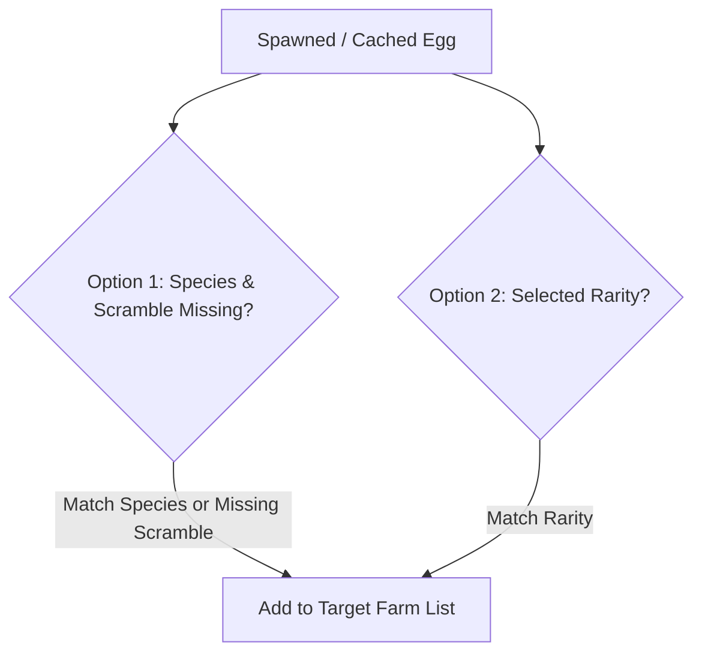

# Current Logic & System Architecture Summary
**Target Codebase:** [`farmer/EggGoToUI_v10.lua`](./EggGoToUI_v10.lua)  
**Version:** v10.0 (Production Release)  
**Date:** October 13, 2026

---

## 1. System Overview & Window Geometry
- **Unified Window Dimensions:** Fixed permanently at `380 x 520` pixels across all tabs (**Eggs**, **Pets**, **Scramble**).
- **Navigation Architecture:** Left icon-only sidebar rail (width `46px`) driving a standard `334px` content container (`380 - 46`).
- **Tab Persistence:** All tabs utilize dedicated `ScrollingFrame` elements with `AutomaticCanvasSize = Enum.AutomaticSize.Y` and zero disruptive window resizing on tab transitions.

```
┌────────────────────────────────────────────────────────┐
│ Main Window (380 x 520)                                │
├─────┬──────────────────────────────────────────────────┤
│ S   │ Content Container (334 x 484)                    │
│ I   │ ┌──────────────────────────────────────────────┐ │
│ D   │ │ Tab 1: Eggs & Autonomous Harvester (380x520) │ │
│ E   │ ├──────────────────────────────────────────────┤ │
│ B   │ │ Tab 2: Pets & Fusery Suite (380x520)         │ │
│ A   │ ├──────────────────────────────────────────────┤ │
│ R   │ │ Tab 3: Dr. Scramble Trade-In Suite (380x520) │ │
│(46px│ └──────────────────────────────────────────────┘ │
└─────┴──────────────────────────────────────────────────┘
```

---

## 2. Egg Name Resolution & Species Aliasing Engine
In "Steal an Egg", egg names vary across server recipes, inventory profile records, physical tool names, and world models:
1. **Dynamic Model Scraping (`loadEggSpeciesFromGame`)**:
   - Dynamically inspects `ReplicatedStorage.Assets.Models.Eggs` for live game species models and populates canonical display names.
2. **String Normalization (`normalizeEggSpecies`)**:
   - Strips mutation prefixes: `Rainbow`, `Golden`, `Gold`, `Silver`, `Shiny`.
   - Strips bracket tags (`[...]`) and redundant trailing `"Egg"` / `"egg"`.
   - Strips all whitespace and punctuation for strict token comparison.
3. **Bidirectional Species Aliasing (`X.EGG_SPECIES_ALIASES` & `matchEggSpecies`)**:
   - Maps internal game category tokens to user-facing names bidirectionally:
     - `Galaxy Gecko` $\longleftrightarrow$ `Cosmic Gecko`
     - `Cyclops Gorilla` $\longleftrightarrow$ `Cosmic Gorilla`
     - `Cave Dragon` $\longleftrightarrow$ `Cosmic Dragon`
     - `Dream Axolotl` $\longleftrightarrow$ `Axolotl`
     - `Holy Peacock` $\longleftrightarrow$ `Peacock`
     - `Warden` $\longleftrightarrow$ `King Snake`
     - `Sacred Moth` $\longleftrightarrow$ `Moth`
     - `Winged Lamb` $\longleftrightarrow$ `Lamb`
     - `King Kong` $\longleftrightarrow$ `Gorilla King`
     - `Shark` $\longleftrightarrow$ `Mutant Shark`
   - **Shark Egg & Mutant Shark Pet Mapping**: In-game egg asset category `Shark` / `Shark Egg` is bidirectionally aliased to `Mutant Shark` (Secret rarity), ensuring that egg detection recognizes Shark eggs for Scramble recipes, species filtering, and pet inventory matching.
   - Guarantees that server recipe requirements (e.g. `Galaxy Gecko`, `Cave Dragon`) instantly recognize satchel inventory eggs (`Cosmic Gecko Egg`, `Cosmic Dragon Egg`) and map world spawns.

---

## 3. AutoFarm Unified Filter Architecture (Option B)
Target selection in the automated harvester operates under a streamlined 2-way `OR` criteria architecture:



1. **Option 1: Explicit Species Dropdown & Scramble Auto-Priority**:
   - Matches any species checked in the multi-select farm dropdown (`selectedSpecies`).
   - **"All" Selection Fix:** When `"All"` is selected in the Farm dropdown, all egg species match universally (`isSpeciesSelected = true`), ensuring all map spawns show in the farm list regardless of rarity filter state.
   - If `prioritizeScrambleInAutoFarm` is enabled, missing Scramble recipe species (`X.scrambleMissingSpecies`) are natively matched in $O(1)$ time via `X.isScrambleMissingEgg(rawCat)`.
   - **Crucial Inventory Gate:** Scramble requirements are strictly matched only while missing from inventory. Once owned or assigned to trade candidate slots, they are no longer matched as missing requirements.
2. **Option 2: Rarity Filter**:
   - Matches any egg whose rarity matches enabled rarity toggles (`Divine`, `Eternal`, `Secret`, `Mythic`, `Legendary`, `Rare`, `Uncommon`, `Common`).
3. **Universal Override: New & Unknown Eggs (UI List Only, Manual "Get")**:
   - Any egg with unresolvable or `"Unknown"` rarity, missing preset classification, unverified field discovery (`missCount == 1`), or explicit new/unknown metadata **automatically shows on the UI egg list** (`updateOrCreateCard`), rendered with a distinctive gold `[NEW/UNKNOWN]` indicator in `createEggCard`.
   - **Excluded from AutoFarm (`pickNearest`):** AutoFarm strictly skips Unknown eggs (`not isNewOrUnknownEgg(r)`), preventing automated harvesting of unverified/unknown egg types.
   - **Manual Target via "Get" Button:** Players can manually target any Unknown egg at any time by clicking the **"Get"** button on the right of its card in Tab 1.
4. **Independent Match Isolation**:
   - For AutoFarm, an egg is farmed if it satisfies **either** enabled option: `return isSpeciesSelected or isRarityMatch` (and is not an Unknown egg).
5. **Priority Order**:
   $$\text{Divine (Tier 1)} \longrightarrow \text{Eternal (Tier 2)} \longrightarrow \text{Secret (Tier 3)} \longrightarrow \mathbf{\text{Scramble Missing (Tier 4)}} \longrightarrow \text{Farther Eggs (Tier 5+)}$$

---

## 4. Egg Detection & Defensive Resilience
- **Multi-Container Detection**:
  - Scans `Workspace.Eggs`, `Workspace.WorldEggs`, `Workspace.Debris`, `LocalPlayer.Character`, and `ClientRenderedAssets` (CRA).
- **Multi-Bump & Temporary Carry Defense**:
  - When an egg is bumped by physics or briefly picked up by another player, it is marked as temporarily held. The scanner does not discard the egg from the cache; once dropped or respawned, tracking resumes immediately.
- **Nil-Safety Defense (`attempt to index nil by Uid`)**:
  - All access to egg metadata enforces defensive nil checks (`egg and (egg.uid or egg.Uid)`), preventing crashes caused by uninitialized network records or transient despawns.

---

## 5. Tab 2: Pets & Fusery Suite (Performance Optimized)
1. **Manual Candidate Loading (`manualRefreshFuseCandidates`)**:
   - Fuse candidate pet lists are **no longer scanned continuously or per frame**.
   - Candidates are loaded on-demand via the manual **Refresh** button or upon explicit pet inventory state changes, eliminating client CPU overhead and preventing server rate-limiting on profile fetch remotes.
2. **Auto-Fuse Execution Cadence**:
   - Auto-fuse execution evaluates recipes on a throttled **10-second fixed cadence**.
3. **Fuse Optimization Pipeline**:
   - `findBestFuseRecipe` identifies combinations yielding highest fusion power and rarity advancement, sorting candidates lightest to heaviest to protect high-tier pets.
   - Executes via server remote `RF/PetFusery/FusePets`.

---

## 6. Tab 3: Dr. Scramble Trade-In Suite (Streamlined, Asynchronous & High-Performance)
1. **Asynchronous & Non-Blocking Execution Architecture**:
   - **Zero UI-Thread Yields:** Network requests (`RF/ScrambleTradeIn/AskState`, `RF/ProfileMirror/FetchProfile`) run asynchronously inside non-blocking `task.spawn` worker threads, preventing UI lockups on tab switching or button clicks.
   - **O(1) Fast-Path Requirement Resolution:** AutoFarm target filtering queries pre-computed hash lookup tables (`X.scrambleMissingSpecies`) in $O(1)$ time, eliminating repetitive tool scans and avoiding infinite RPC storms when storage has 0 eggs.
   - **15-Second Throttled Auto-Trade Evaluation:** Auto-trade candidate verification and auto-execution operate on a relaxed **15-second evaluation interval** (`15sPoll`), eliminating unnecessary CPU overhead and network RPC storms.
   - **Trailing Debounced Backpack Watcher:** `Backpack.ChildAdded` and `ChildRemoved` employ a 2.5-second trailing debounce, batching rapid equip/unequip events into a single query.
   - **Decoupled UI Rendering:** Scramble inventory updates set `X.listDirty = true` without forcing synchronous DOM destructions on Tab 1 (`Eggs`).
2. **Compact Controls Bar (2-Row Layout, Height: 56px)**:
   - **Row 1:** Live rotation timer countdown (`timerBadge`, width `1, -34`) with 15s safe backoff floor + Async Manual Refresh (`refreshBtn`, 28x26, shows `⏳` spinner).
   - **Row 2:** Priority Toggle (`priorityToggleBtn`, 32%), Auto-Trade Toggle (`autoTradeToggleBtn`, 34%), Trade Action Button (`manualTradeBtn`, 34%).
3. **Virtualized 2-Card UI Architecture**:
   - **Card 1: Recipe Requirements (Auto-Height & In-Place Row Recycling)**:
     - Maintains persistent requirement row cards (`slotRowFrames[1..3]`), mutating text, borders, and color properties in-place without `:Destroy()` or `Instance.new()` memory churn.
     - **Off-Screen Rendering Gate:** Skips DOM updates whenever Tab 3 is hidden (`tabScramble.Visible == false`), updating internal data tables only.
     - Shows canonical display name, required count, and inventory count (`Inventory: %d copy/copies`) with status badge (`[✓ OWNED]` / `[⚠️ MISSING]`).
   - **Card 2: Live Telemetry & Log (Height: 200px)**:
     - High-performance debounced terminal with 60-message ring buffer and deferred layout calculation.
     - One-click `Copy` (system clipboard) and `Clear` buttons.
4. **Authoritative 3-Step Trade Cycle**:
   1. `RF/ScrambleTradeIn/AskState`: Retrieves active recipe and automatically claims any pending rewards.
   2. `RF/ScrambleTradeIn/AskTradeIn`: Submits ordered distinct 32-hex UIDs `finalUids` (`[1]=uid1, [2]=uid2, [3]=uid3`).
   3. `RF/ScrambleTradeIn/AskFinishReveal`: **Crucial claim step** that unlocks the next recipe and deposits pet rewards into the player's satchel.
5. **Strict Safety Gates & Cleanup Lifecycle**:
   - **Strict Egg Filter:** Verifies `Placement == nil` and validates item category to ensure pets are never sacrificed.
   - **Carrying State Protection:** Auto-trade executions are strictly deferred while `weAreCarrying == true` until the carried egg is safely delivered to home base.
   - **Full Connection Cleanup:** All event listeners (`Backpack`, `RE/BannerRotated`) are registered in `connections` and cleanly destroyed on script shutdown.

---

## 7. Physics, Navigation & Anti-Rubberband Protection
1. **Dual-Velocity State Machine**:
   - **Travel Speed (`baseVelocity = 300`)**: Active during target navigation, scouting, and retargeting.
   - **Carry Speed (`baseCarryVelocity = 250`)**: Clamped automatically on `weAreCarrying` or confirmed pickup to prevent fling physics and server rubberband triggers.
2. **Frictionless Normalization**:
   - Local character parts set to custom physical properties: `PhysicalProperties.new(0.7, 0, 0, 100, 100)`.
   - Carried egg models set to `Massless = true` and `CanCollide = false`.
3. **Anti-Rubberband Step-Down (`detectRubberband`)**:
   - Samples character displacement over `0.6s`. If pulled backward $\ge 6$ studs in a frame or $\ge 12$ studs over the window, speed drops by `10 studs/s` down to `100 studs/s` minimum until smooth movement resumes.
4. **Micro-Snap Distance Gating**:
   - Approach walks (`walkTo`) engage a 50-stud proximity snap (`SNAP_RADIUS = 50`) aligned beside the target at ground level (`targetY`).
   - Hard micro-snaps are clamped to $\le 75$ studs (`SAFE_SNAP_RADIUS = 75`) to avoid anti-cheat kicks or ragdoll loops.

---

## 8. Zero-Wait Instant Ragdoll Recovery Engine (v10.0 Upgrade)
Ported from [`instant-ragdoll-recovery.lua`](../instant-ragdoll-recovery.lua) to eliminate the 2–3s stun/ragdoll delay on boss bumps:
1. **Attribute Zeroing & Metamethod Spoofing**:
   - **Metamethod `__namecall` Hook:** Spoofs `GetAttribute("RagdollEndTime")` and `"RagdollTime"` to return `0` to game client scripts, forcing game scripts to exit internal ragdoll loops immediately.
   - **`clearRagdollAttributes()`:** Wipes `RagdollEndTime = 0`, `RagdollTime = 0`, `IsRagdoll = false`, `Ragdolled = false` locally on both `LocalPlayer` and `Character`.
2. **Joint & Humanoid Metamethod Protection (`__newindex`)**:
   - Intercepts writes on `Motor6D`: blocks `Enabled = false` (forces `true`).
   - Intercepts writes on `Humanoid`: blocks `PlatformStand = true` (forces `false`), blocks `WalkSpeed = 0` (preserves active running speed / `targetVelocity`).
3. **Player Controls Restorer (`enablePlayerControls`)**:
   - Invokes `require(LocalPlayer.PlayerScripts.PlayerModule):GetControls():Enable()` immediately to unfreeze keyboard (WASD) and touch inputs.
4. **Instant State Transition (`executeInstantRecovery`)**:
   - Clears `PlatformStand = false`, `Sit = false`, and restores `AutoRotate = true`.
   - Re-enables humanoid states (`GettingUp`, `Running`, `Physics`, `Ragdoll`, `FallingDown`).
   - Executes immediate state transitions: `hum:ChangeState(GettingUp)` followed by `hum:ChangeState(Running)`.
   - Zero-frame restores all Motor6D joints indexed in `X.jointsTable`.
5. **Anti-Fling Braking & Fast Downward Grounding**:
   - **Bump Location Retention (Anti-Fling):** Immediately halts horizontal knockback velocity ($V_x = 0, V_z = 0$) upon boss bump and ragdoll recovery, preventing the character from being flung away across the map so they stay right beside the dropped egg.
   - **Fast Grounding (No Slow Float):** Completely eliminates the slow `-5` studs/s floating clamp. If airborne or knocked upward, immediately cancels upward launch and accelerates downward fast ($V_y = -45$) to ground the character in $\sim 0.1\text{s}$ flat.
   - **Natural Motion Restoration:** Eliminates artificial forward fling impulses (`wasRagdolledForVelocity`) upon recovery so movement is purely driven by directional input.
6. **Integration with AutoFarm Bump-Retry Lifecycle**:
---

## 9. Performance Optimization & Stutter Elimination
1. **Boost FPS & Telemetry Removal**:
   - Per user request, the Boost FPS engine (`setFPSBooster`, lighting overrides, particle disabling, `farm.json` persistence) has been completely removed.
   - Eliminates engine-level QualityLevel resets and particle traversal overhead.
2. **Metamethod `__newindex` Ultra Fast-Path**:
   - Intercepting `__newindex` on `game` without an immediate property key filter forced every single property set across the entire game engine (CFrame, animations, camera, UI) into Lua C-boundary checks (`not checkcaller()`, `typeof()`, `IsDescendantOf`).
   - Refactored with an ultra fast-path key check (`key == "WalkSpeed"`, `key == "PlatformStand"`, `key == "Enabled"`). 99.999% of normal game property writes now execute an immediate native return with zero overhead, completely eliminating frametime micro-stutter.
3. **Egg Refresh DOM Recycling & Card Pooling (`cardPool`)**:
   - **Root Cause of Refresh Hitching:** Previously, `clearList()` called `:Destroy()` on all Frame cards in `listFrame` on every scan. For ~50 field eggs with 10 GuiObjects each, 500+ UI instances were destroyed and 500+ instantiated every second, creating massive Garbage Collection and layout engine hitches.
   - **Zero-Allocation Card Pool:** Implemented `updateOrCreateCard(idx, r)`. Cards are created once up to the maximum displayed count and reused indefinitely. Successive refreshes mutate properties (`.Text`, `.TextColor3`, `.BackgroundColor3`, `.Visible`) in-place. Cards beyond the active count are hidden (`Visible = false`) with zero destruction churn, dropping refresh execution time from ~50–80ms down to <0.5ms.
4. **Stable Egg List Signature (`lastListSig`)**:
   - Previously, `onEggCacheUpdate` concatenated volatile floating-point coordinates `(p.X, p.Y, p.Z)` into the signature string. Microscopic physics jitter caused the signature to differ on every single tick, completely defeating signature-based change detection.
   - Replaced with a stable identifier: `table.concat({ r.uid, r.category or "", r.mutations or "" }, ":")`. When the egg roster has not changed, the update pass skips DOM manipulation entirely.
5. **Preset Rarity Memoization (`presetRarityCache`)**:
   - `getPresetRarity` previously performed a linear scan over 100+ preset definitions on every call across `resolveRaw`, `effectiveRarity`, and `isNewOrUnknownEgg`.
   - Introduced `presetRarityCache[speciesName]`, memoizing lookup results on first query and reducing subsequent lookups to $O(1)$ table index operations.
6. **Workspace Base Plot Caching (`baseRendersCache`)**:
   - Previously, `isEggInBaseRenders` invoked `per:GetChildren()` and looped string substring searches for every egg on every frame (hundreds of traversals/sec).
   - Added a 0.8-second TTL hash cache `baseRendersCache` that stores mapped UIDs, turning per-egg base checks into instant $O(1)$ lookups.
7. **Area Egg Slots Hierarchy Caching**:
   - `updateSlotGhosts` now fetches `area:GetChildren()` once per pass and passes the pre-resolved table into `findEggSlot`, eliminating 3–4 redundant hierarchy traversals per egg.
8. **Streamlined Filter Pipeline & Closure Allocation Elimination**:
   - Extracted `matchSpeciesFilter` out of `passesFilters` to avoid per-egg closure allocations.
   - Removed redundant calls to `isCarriedByOther`, `deliveredUids`, and `isEggInBaseRenders` in `passesFilters` that were already performed by `isGhost`.
9. **CRA Proximity Loop Pruning**:
   - Removed the `cra_near` proximity loop from `holdingSource()`, eliminating per-heartbeat `ClientRenderedAssets` child scans and recursive searches.
   - Also prevents false-positive egg pickup detections during autofarm.
10. **PlayerControls Caching & Motor6D Direct Restoration**:
    - Cached `cachedPlayerControls` so `require(PlayerModule):GetControls()` is not executed repeatedly.
    - Streamlined `executeInstantRecovery` to restore Motor6Ds directly from `jointsTable` without rescanning `char:GetDescendants()`.

---

## 10. UI Layout & Window Geometry Optimization
1. **Container Budget**:
   - Main window width: `380px`.
   - Sidebar rail width: `46px`.
   - Content container width: `334px` (`380 - 46`).
2. **Row 2 Geometry Alignment (Recovery & Velocity Stats)**:
   - With Boost FPS removed, Row 2 features a clean, symmetrical dual-widget layout:
     - `recoveryToggleBtn`: Width `152px` (Pos X = `12`, Left Margin = `12px`)
     - Gap: `6px`
     - `velStatusLabel`: Width `152px` (Pos X = `170`, Right Margin = `12px`)
   - Total width: $12 + 152 + 6 + 152 = 322\text{px}$ inside the $334\text{px}$ container, providing exact `12px` symmetric padding on both edges.

---

## 11. Tab 4: Utility Suite Architecture (Minimal Two-Column Layout: Text | ON/OFF)
1. **Sidebar Navigation Rail**:
   - Tab 1: 🥚 Eggs (`Y = 10`)
   - Tab 2: 🐾 Pets (`Y = 50`)
   - Tab 3: 🌀 Dr. Scramble (`Y = 90`)
   - Tab 4: 🛠️ Utility (`Y = 130`)
2. **Dedicated Container (`tabUtility`)**:
   - Clean container inside `contentContainer` (`334px` width) with `UIListLayout` (padding 8px) and `UIPadding` (10px horizontal, 10px vertical).
   - Fully wired into `switchTab("Utility")` with active state highlighting and mutual exclusivity across tabs.
3. **Pure Two-Column Toggle Row (`Text | ON/OFF`)**:
   - Single clean setting row (`36px` height):
     - **Left Column:** `TextLabel` showing `"Spam Pickup [E]"` (aligned left, bold, readable).
     - **Right Column:** `TextButton` showing `"ON"` (green `35, 135, 75`) or `"OFF"` (dark `45, 50, 65`).
   - Zero other text or widgets on the panel (no status labels, headers, or guides).
4. **Embedded Logic & High-Performance Operations**:
   - All logic from `Pickup.lua` is fully embedded and deduplicated:
     - **Code Reuse:** Dispatches carry RPCs via unified `carryEgg(uid, sl, burstCount)`, eliminating duplicate network remote lookups and loops.
     - **Direct Authoritative Cache:** Directly queries `eggCache.byUid` from the primary egg scanner rather than maintaining a duplicate snapshot polling loop or duplicate network event listeners.
     - **On-Demand Target Evaluation (FPS Fix):** Evaluates camera and character focus scores ONLY when `[E]` is tapped. Completely eliminates the `RunService.Heartbeat` per-frame Workspace hierarchy scan that caused frame drops.
     - **Reach Assist:** Repositions character $2.8\text{ studs}$ beside the egg facing it and marks teleport via `X.markTeleport()`.
     - **Keybind Listener:** Listens on `[E]` keypress with typing suppression (`GetFocusedTextBox() ~= nil`).
5. **Clean Lifecycle**:
   - Managed cleanly in `fullCleanup()` via `X.utilityCleanup` and connection disconnection.

---

## 12. Luau Local Variable Limit Optimization (200-Locals Architecture Fix)
1. **Root Cause Analysis ("No UI Show" on Execution)**:
   - Luau and Lua 5.3 strictly limit any single function scope to a maximum of **200 local variables**.
   - Because `EggGoToUI_v10.lua` is wrapped in `local ok, err = pcall(function() ... end)`, the entire top-level script belongs to a single function scope.
   - When Tab 4 Utility logic was introduced, the outer local variable count increased to **202 locals**, exceeding the 200 threshold.
   - Luau enforces this at compile time (`too many local variables (limit is 200)`), causing `loadstring()` / script compilers to immediately abort before any code runs, resulting in no UI rendering.
   - Additionally, `X.PICKUP_CONFIG = PICKUP_CONFIG` was positioned above `local X = { ... }`, attempting to index a nil global.
2. **Refactoring & Scope Consolidation**:
   - Integrated `PICKUP_CONFIG` directly into table `X` (`X.PICKUP_CONFIG = { ... }`), aliased locally within `buildUtilityTabUI()`.
   - Converted tab builder functions to methods on `X`: `X.buildPetsTabUI()`, `X.buildScrambleTabUI()`, `X.buildUtilityTabUI()`, `X.buildMainUI()`.
   - Consolidated movement constants into table `X`: `X.SLOW_ZONE`, `X.TELEPORT_ZONE`, `X.SNAP_RADIUS`, `X.SNAP_Y_OFFSET`, `X.SAFE_ARRIVE_RADIUS`, `X.SAFE_SNAP_RADIUS`.
   - Consolidated autofarm constants into table `X`: `X.AUTO_RETRY`, `X.PICKUP_SPAM`, `X.AUTO_NEXT_DELAY`, `X.AUTO_EMPTY_WAIT`, `X.AUTO_CARRY_WAIT`, `X.HOLD_RELEASE_TIMEOUT`, `X.WALK_TIMEOUT`, `X.EGG_SCAN_INTERVAL`, `X.DROP_CONFIRM`.
   - Consolidated card recycling DOM into table `X`: `X.CARD_HEIGHT`, `X.cardPool`.
   - Consolidated ragdoll flags into table `X`: `X.RAGDOLL_STALE_AFTER`, `X.wasRagdolledForVelocity`.
3. **Verification**:
   - Outer local variable count reduced from **202 to 177** (23 slots buffer below the 200 limit).
   - AST validation and Lua compiler testing confirmed clean syntax and successful load (`LUA_OK`, 0 errors).

---

## 13. Shark Egg, Carry Deduplication & Performance Optimization Fixes
1. **Issue 1: Shark Egg $\longleftrightarrow$ Mutant Shark Pet Alignment**:
   - In-game egg model uses `AssetCategory = "Shark"`, whereas the hatched pet / Scramble recipe requirement is `"Mutant Shark"`.
   - Restored bidirectional aliasing in `X.EGG_SPECIES_ALIASES`: `["shark"] = "mutant shark"` and `["mutant shark"] = "shark"`.
   - Added display mapping in `X.CATEGORY_TO_DISPLAY`: `["Shark"] = "Mutant Shark"`.
   - Aligned preset rarity in `PET_RARITY_PRESETS`: `["Shark"] = "Secret"` and updated `resolveRaw(r)` to check display name resolution, ensuring Shark eggs match Secret rarity filters and Scramble requirements.
2. **Issue 2: Carry Remote Deduplication**:
   - Unified carry invocation into `carryEgg(uid, sl, burstCount)` with exported `X.carryEgg`.
   - Tab 4 Spam Pickup reuses `carryEgg` for $8\times$ burst invocations rather than maintaining duplicate remote finders and independent task loops.
3. **Issue 3: FPS Optimization**:
   - Removed `RunService.Heartbeat` continuous focus scanning (`getBestFocusedTarget` was iterating the egg cache and running `Workspace.AreaEggSlotsClient:GetChildren()` every single frame).
   - Removed redundant 2.5s snapshot polling loop and duplicate network event listeners (`FieldEggShifted`, `BatchShifted`, `OwnerDropped`, `FieldEggGone`).
   - Focused target calculation is now executed purely on-demand when `[E]` is pressed.
4. **Issue 4: Unknown Eggs Excluded from AutoFarm (List Display & Manual "Get" Only)**:
   - Unknown / unverified eggs (`isNewOrUnknownEgg(r)`) continue to appear unconditionally on the Tab 1 list with the `[NEW/UNKNOWN]` indicator.
   - AutoFarm candidate selection in `pickNearest` explicitly ignores all Unknown eggs (`and not (X.isNewOrUnknownEgg and X.isNewOrUnknownEgg(r))`), ensuring AutoFarm never automatically targets or harvests them.
   - Players can manually target any Unknown egg by clicking the green **"Get"** button on its card.
   - Enhanced `getEgg` click handler with multi-tier fallback position lookup (`item.pos -> eggCache.byUid[uid] -> X.nestPos[uid]`) and exempted manual gets from filter invalidation aborts.


