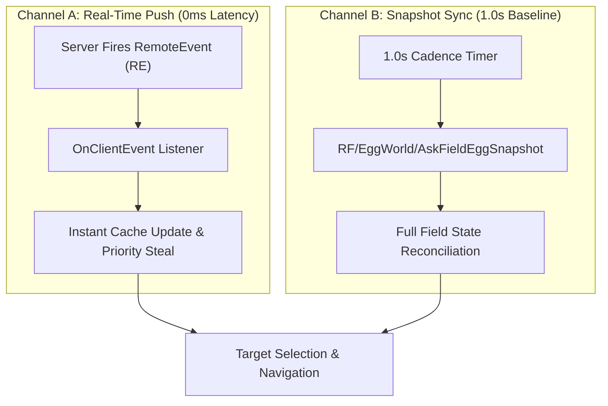
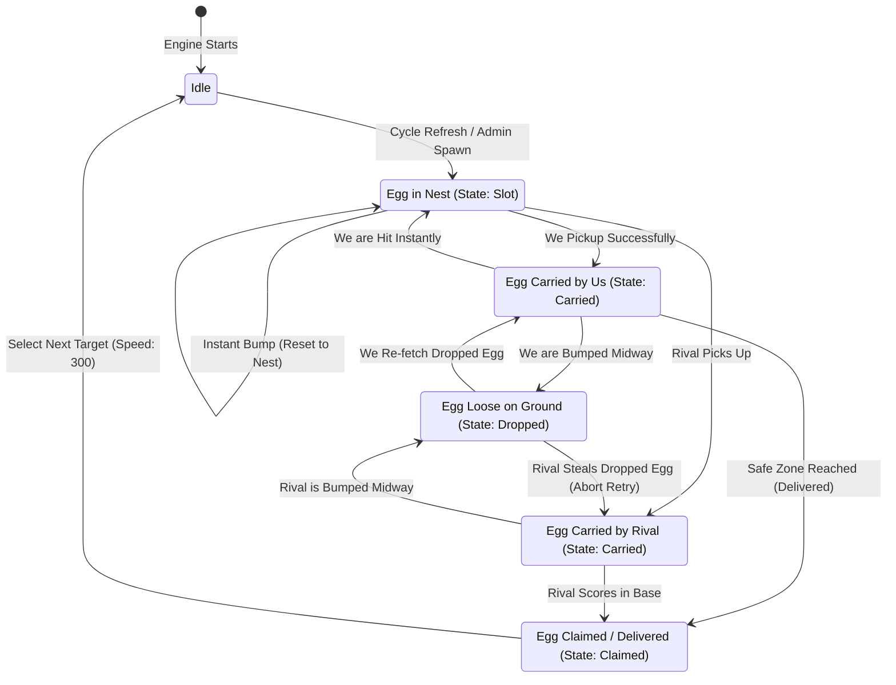

# Egg Detection Architecture & Engine Guide

This document details how egg detection, state transitions, and real-time network hooks work in the engine. It covers the dual-channel detection pipeline, the complete 12-instance gameplay matrix, and a concrete Luau implementation blueprint for fast-paced stealing with zero FPS drop.

---

## 1. Dual-Channel Detection Pipeline

Egg detection operates across two complementary channels to ensure **0ms reaction time** without polling lag:



1. **Channel A (Real-Time Push - 0ms):**
   - The game server fires RemoteEvents whenever an admin spawns eggs, a night cycle triggers, or an egg is dropped/carried.
   - Listens via `OnClientEvent` to react in **under 10ms**, beating any timer-based polling script.

2. **Channel B (Background Snapshot - 1.0s):**
   - A single, non-blocking background loop queries the authoritative world state every 1.0 second.
   - Reconciles any eggs that were missed during player respawns, late logins, or streaming pauses.

---

## 2. Network Remotes Reference

All egg networking lives under `ReplicatedStorage.Packages.Networking`:

| Remote Path | Type | Purpose |
| :--- | :--- | :--- |
| `RE/EggWorld/FieldEggRaritiesShown` | RemoteEvent | **Instant Push:** Fired when rare/special eggs (Divine, Eternal, Secret) spawn on the field. |
| `RE/EggWorld/FieldEggBatchShifted` | RemoteEvent | **Instant Push:** Fired when an entire wave/batch of eggs spawns (admin events or 5-min cycles). |
| `RE/EggWorld/FieldEggShifted` | RemoteEvent | **Real-Time Push:** Fired when an egg changes state (`"Dropped"`, `"Carried"`, `"Claimed"`, `"Slot"`). |
| `RF/EggWorld/AskFieldEggSnapshot` | RemoteFunction | **Field Snapshot:** Queries the complete list of all active eggs and rare spawns currently in the world. |
| `RF/EggWorld/AskFieldEggCarry` | RemoteFunction | **Pickup Request:** Dispatched when close to an egg to initiate pickup and carry. |

---

## 3. Egg Record Anatomy

When a snapshot is fetched or a push event fires, the server supplies a table record with the following key attributes:

```lua
local eggRecord = {
    Uid           = "a1b2c3d4e5f6...",       -- 32-character unique hexadecimal ID
    AssetCategory = "Godzilla",               -- In-game asset model name (mapped via EGG_ALIASES)
    DisplayName   = "Nightflame",            -- Canonical pet display name
    RarityId      = "Divine",                 -- Tier: Common -> Divine
    State         = "Slot",                   -- "Slot", "Dropped", "Carried", or "Claimed"
    CarrierUserId = nil,                      -- UserId of player carrying the egg (if State == "Carried")
    AreaId        = "Titan Temple",           -- Biome zone name
    NestId        = "Slot_004",               -- Specific nest identifier
    BoundsCFrame  = CFrame.new(120, 5, -340), -- Authoritative world coordinates
    Mutations     = { "Golden" }              -- Active mutation tags (if any)
}
```

---

## 4. Complete 12-Instance Gameplay Matrix

The engine maps all real gameplay scenarios into 4 canonical server states:

| # | Gameplay Scenario | Server Signal / State | Engine Priority & Reaction |
| :-: | :--- | :--- | :--- |
| **1** | **5-Min Night Refresh** | `BatchShifted` / `State = "Slot"` | Full wave spawns. Evaluates highest priority egg by rarity/biome filter. |
| **2** | **You Picked Up & Instantly Hit** | `Shifted (State = "Slot")` | Egg snapped back to nest. Immediately retargets nest or resets carry state. |
| **3** | **You Picked Up & Hit Midway** | `Shifted (State = "Dropped")` | Egg dropped loose on ground. **Immediate high priority:** Re-fetches dropped egg. |
| **4** | **Opponent Picks Up Egg** | `Shifted (State = "Carried")` | `CarrierUserId ~= LocalPlayer.UserId`. Egg is ignored unless configured to bump. |
| **5** | **Opponent Hit Midway** | `Shifted (State = "Dropped")` | Opponent dropped egg. Marked as loose target; available for high-speed intercept. |
| **6** | **Opponent Hit Instantly** | `Shifted (State = "Slot")` | Egg reset back to nest. Re-evaluated as standard nest target. |
| **7** | **Admin Spawns Egg** | `RaritiesShown` (0ms push) | **Instant Steal Alert:** Immediately overrides lower targets and sets waypoint. |
| **8** | **Egg Successfully Delivered** | `Shifted (State = "Claimed")` | Egg secured in base plot. Switches to Travel Speed (300) and selects next target. |
| **9** | **Opponent Steals Your Dropped Egg** | `Shifted (State = "Carried")` | While running to fetch dropped egg, rival grabs it. **Aborts retry & blacklists instantly.** |
| **10**| **Cycle Expiry / Day Transition** | `FieldEggGone` / Despawn | Uncollected eggs despawn. Cleared from cache so character never visits empty nests. |
| **11**| **Carrier Void Fall / Death** | `Shifted (State = "Dropped")` | Carrier fell off cliff / died. Egg lands at ground edge or resets to nest. |
| **12**| **Late Login / Streaming Delay** | `Snapshot.Records` present | Client 3D models not streamed yet. Navigates directly via server `BoundsCFrame`. |

---

## 5. State Machine Transition Flow



---

## 6. Concrete Implementation Blueprint (v11 Luau Engine)

Below is the clean, high-performance implementation architecture to be integrated into `EggGoToUI_v11.lua`:

### 6.1. State Store & Fast Index
```lua
local eggCache = {
    records = {},        -- Ordered list of active records
    byUid   = {},        -- O(1) dictionary by UID
    blacklist = {},      -- Temporarily blacklisted UIDs (stolen eggs, expiry)
}
local currentTargetUid = nil
local activeDropRetry  = nil -- { uid = string, dropPos = Vector3, attempts = number }
```

### 6.2. Push Event Listener (0ms Real-Time Reaction)
```lua
local function startPushMonitor()
    local net = ReplicatedStorage:FindFirstChild("Packages")
        and ReplicatedStorage.Packages:FindFirstChild("Networking")
    if not net then return end

    local evShift   = net:FindFirstChild("RE/EggWorld/FieldEggShifted")
    local evRarities= net:FindFirstChild("RE/EggWorld/FieldEggRaritiesShown")
    local evBatch   = net:FindFirstChild("RE/EggWorld/FieldEggBatchShifted")

    -- 1. Handle Single Egg State Shift
    if evShift then
        addConnection(evShift.OnClientEvent:Connect(function(payload)
            if typeof(payload) ~= "table" then return end
            local uid = tostring(payload.Uid or payload.EggUid or "")
            if uid == "" then return end

            local state = payload.State
            local carrier = payload.CarrierUserId

            if state == "Claimed" then
                -- Case 8: Secured in base plot
                eggCache.byUid[uid] = nil
                if currentTargetUid == uid then
                    onTargetDelivered(uid)
                end

            elseif state == "Carried" then
                local isMe = carrier and tostring(carrier) == tostring(LocalPlayer.UserId)
                if isMe then
                    -- We are carrying! Switch to carry speed & safe zone route
                    onEggPickedUp(uid)
                else
                    -- Case 4 & Case 9: Opponent carrying
                    if eggCache.byUid[uid] then
                        eggCache.byUid[uid].State = "Carried"
                        eggCache.byUid[uid].CarrierUserId = carrier
                    end
                    -- If rival stole the egg we were running back to re-pick, abort immediately!
                    if activeDropRetry and activeDropRetry.uid == uid then
                        activeDropRetry = nil
                        eggCache.blacklist[uid] = os.clock() + 10 -- Blacklist for 10s
                        retargetNextEgg()
                    end
                end

            elseif state == "Dropped" then
                -- Case 3 & Case 5: Loose on ground
                if eggCache.byUid[uid] then
                    eggCache.byUid[uid].State = "Dropped"
                    if payload.BoundsCFrame then
                        eggCache.byUid[uid].BoundsCFrame = payload.BoundsCFrame
                    end
                end
                -- If we dropped it, flag for immediate recovery
                if payload.UserId and tostring(payload.UserId) == tostring(LocalPlayer.UserId) then
                    activeDropRetry = { uid = uid, dropPos = payload.BoundsCFrame and payload.BoundsCFrame.Position }
                    onWeDroppedEgg(uid)
                end
            end
        end))
    end

    -- 2. Handle Admin / Wave Spawns (0ms Instant Alert)
    local function onWaveSpawn(data)
        -- Instantly flag cache dirty & trigger highest priority steal without UI DOM lag
        task.defer(function()
            syncEggSnapshot()
            evaluateHighestPriorityTarget()
        end)
    end

    if evRarities then addConnection(evRarities.OnClientEvent:Connect(onWaveSpawn)) end
    if evBatch then addConnection(evBatch.OnClientEvent:Connect(onWaveSpawn)) end
end
```

### 6.3. Target Evaluation (Zero-Lag $O(1)$)
```lua
local function evaluateHighestPriorityTarget()
    local bestTarget = nil
    local bestScore  = -1

    for uid, record in pairs(eggCache.byUid) do
        -- Skip claimed, rival-carried, or blacklisted eggs
        if record.State ~= "Claimed" and not eggCache.blacklist[uid] then
            local isCarriedByRival = record.State == "Carried" and tostring(record.CarrierUserId) ~= tostring(LocalPlayer.UserId)
            if not isCarriedByRival then
                -- Priority 1: An egg we just dropped (immediate recovery)
                if activeDropRetry and activeDropRetry.uid == uid then
                    return record
                end

                -- Priority 2: Rank based on rarity & user filter
                local info = getSpeciesInfo(record.DisplayName or record.AssetCategory)
                local rank = info and info.Rank or 0
                if rank > bestScore then
                    bestScore = rank
                    bestTarget = record
                end
            end
        end
    end

    return bestTarget
end
```

---

## 7. Performance Checklist for Implementation

- [x] **No Workspace Child Searches:** Navigate directly to `record.BoundsCFrame.Position`.
- [x] **Single-Threaded Carry:** Send 1 clean `AskFieldEggCarry` invocation upon arrival.
- [x] **Decoupled UI Rendering:** Keep AutoFarm loop separate from list redraws to guarantee uninterrupted 60+ FPS.
- [x] **Immediate Stolen Drop Abort:** If an opponent steals our dropped egg, immediately purge retry to prevent getting stuck in a loop.

---

## 8. Full List JSON Export & Analysis

To identify why certain eggs may be misidentified or flagged with incorrect rarities (e.g. eggs named generic `"Egg"`, non-standard `AssetCategory`, or rare tiers delivered in `res.RareSpawns`), the UI includes a **"Copy JSON"** button in the list header.

### 8.1. Export Schema
```json
{
  "exportedAt": "2026-10-19T22:38:00Z",
  "totalCached": 42,
  "totalFarmable": 35,
  "farmableEggs": [ ... ],
  "allEggs": [
    {
      "uid": "egg_12345",
      "displayName": "Chicken",
      "rawName": "Chicken",
      "assetCategory": "ForestEgg",
      "speciesMatched": true,
      "matchedSpeciesName": "Chicken",
      "serverRarityId": "Common",
      "catalogRarity": "Common",
      "finalRarity": "Common",
      "raritySource": "catalog",
      "rank": 1,
      "biome": "Forest",
      "state": "Slot",
      "carrierUserId": null,
      "isFarmable": true,
      "position": { "X": 105.2, "Y": 12.0, "Z": -43.5 },
      "distance": 84.1,
      "rawRecord": {
        "Uid": "egg_12345",
        "DisplayName": "Chicken",
        "BoundsCFrame": { "X": 105.2, "Y": 12.0, "Z": -43.5 }
      }
    }
  ]
}
```

### 8.2. Rarity Audit Matrix
| `raritySource` | Meaning | Investigation Path |
| :--- | :--- | :--- |
| `server` | Rarity came directly from `res.RareSpawns` or `r.RarityId`. | Authoritative; check if game server classified the egg tier. |
| `catalog` | Rarity matched species name via `BIOME_EGG_CATALOG`. | Check `matchedSpeciesName` and aliases. |
| `fallback_unknown` | Neither server nor catalog matched; fell back to Common/Rank 1. | Inspect `rawName`, `assetCategory`, and `rawRecord` in the dumped JSON to add the missing alias or species name. |
