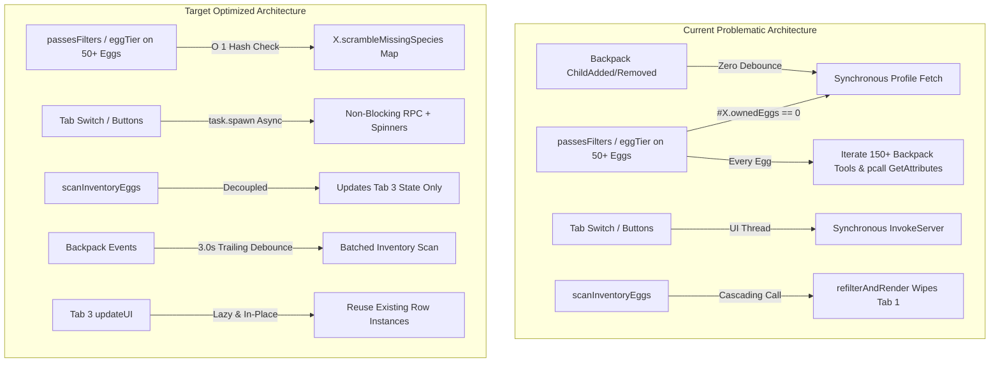

# Dr. Scramble Auto Trade-In Suite: Performance Optimization & Architecture Plan

## Executive Summary

This plan outlines the architecture, code refactoring, and performance optimizations required to eliminate client freezes, frame drops, and network throttling caused by the Dr. Scramble Auto Trade panel in [`farmer/EggGoToUI_v9_9.lua`](./EggGoToUI_v9_9.lua).



---

## 1. Root Causes & Problem Formulation

| ID | Issue Description | Root Cause | Impact |
| :--- | :--- | :--- | :--- |
| **B1** | **Infinite RPC Storm on 0 Eggs** | [`L601-L603`](./EggGoToUI_v9_9.lua#L601-L603): Guard condition `(not X.ownedInventoryEggs or #X.ownedInventoryEggs == 0)` treats having 0 owned eggs as uninitialized cache. | Every egg evaluated on map (~50 eggs) triggers synchronous `RF/ProfileMirror/FetchProfile` 50x/sec. Drops FPS to < 5. |
| **B2** | **Synchronous UI Thread Yields** | [`L6245`](./EggGoToUI_v9_9.lua#L6245), [`L5311`](./EggGoToUI_v9_9.lua#L5311), [`L5265`](./EggGoToUI_v9_9.lua#L5265): `switchTab`, `refreshBtn`, and `priorityToggleBtn` call `InvokeServer` on main Luau thread. | Complete UI freeze (500ms–2000ms) on tab switch or button clicks. |
| **B3** | **Tab 1 DOM Thrashing** | [`L5466`](./EggGoToUI_v9_9.lua#L5466): `scanInventoryEggs()` calls `refilterAndRender()`. | Wipes all Tab 1 card instances (`clearList`) and rebuilds them even when viewing Tab 3. |
| **B4** | **$O(\text{Eggs} \times \text{Backpack})$ Tool Iteration** | [`L605-L663`](./EggGoToUI_v9_9.lua#L605-L663): `isScrambleEggNeeded` scans 150+ Backpack tools with `pcall(GetAttributes)` before checking species match. | Thousands of `pcall` allocations and string operations per second. |
| **B5** | **Backpack Event Flooding** | [`L5903-L5926`](./EggGoToUI_v9_9.lua#L5903-L5926): `ChildAdded` and `ChildRemoved` fire with zero debounce on tool equips/unequips. | Multiple overlapping `FetchProfile` network calls. |
| **B6** | **Concurrent Polling Loops** | Two separate 10s polling loops (Tab 3 loop at [`L5988`](./EggGoToUI_v9_9.lua#L5988) + `autoFarmLoop` at [`L3171`](./EggGoToUI_v9_9.lua#L3171)) + delivery checks ([`L3154`](./EggGoToUI_v9_9.lua#L3154), [`L2995`](./EggGoToUI_v9_9.lua#L2995)). | Redundant profile deserialization and network RPC hammering. |
| **B7** | **Destructive DOM Re-renders** | [`L5644-L5715`](./EggGoToUI_v9_9.lua#L5644-L5715): `updateUI()` calls `:Destroy()` on all rows and recreates 9+ instances per slot. Runs even when hidden. | Layout reflows, Lua-C++ bridge overhead, GC churn. |
| **B8** | **Hourly Timer 1s Loop Trap** | [`L5962-L5977`](./EggGoToUI_v9_9.lua#L5962-L5977): If `serverExpiresAt` expires or returns $\le 0$, `diff <= 0` triggers every 1.0s. | Infinite 1-second server query storm. |
| **B9** | **Log Terminal Allocations** | [`L5230-L5240`](./EggGoToUI_v9_9.lua#L5230-L5240): `table.remove(log, 1)` and `table.concat` on 180 lines inside auto-sized labels. | TextLayout recalculations and micro-stutters. |
| **B10** | **Connection Memory Leaks** | [`L5903-L5942`](./EggGoToUI_v9_9.lua#L5903-L5942): Backpack and RemoteEvent connections are never added to `connections` table. | Zombie handlers persist across script reloads. |
| **B11** | **Filter Logic Bug** | [`L2049`](./EggGoToUI_v9_9.lua#L2049), [`L2124`](./EggGoToUI_v9_9.lua#L2124): `passesFilters` and `eggTier` check `(X.prioritizeScrambleInAutoFarm or X.autoScrambleTrade)`. | AutoFarm farms Scramble eggs even when Priority is OFF. |

---

## 2. Refactoring & Implementation Plan

### Phase 1: High-Performance Egg Need Resolution ($O(1)$)
- **Goal:** Neutralize the 0-egg infinite loop and eliminate tool iteration during world scans.
- **Tasks:**
  1. Add an explicit boolean initialization flag `X.scrambleInventoryLoaded = false`.
  2. In [`X.isScrambleEggNeeded(sp)`](./EggGoToUI_v9_9.lua#L595):
     - Replace the `#X.ownedInventoryEggs == 0` check with `not X.scrambleInventoryLoaded`.
     - Early-exit immediately if `sp` does not match any recipe requirement:
       ```lua
       local isReq = false
       for _, req in ipairs(X.scrambleRequirements or {}) do
           if X.matchEggSpecies(sp, req.species) then isReq = true; break end
       end
       if not isReq then return false end
       ```
     - Leverage `X.scrambleMissingSpecies` as the primary lookup map ($O(1)$) instead of re-iterating `Backpack` and `Character` children on every egg call.
  3. Ensure `X.scanInventoryEggsForScramble` sets `X.scrambleInventoryLoaded = true`, even if the satchel contains 0 eggs.

### Phase 2: Asynchronous RPC Offloading
- **Goal:** Prevent UI buttons and tab switches from blocking the Luau execution thread.
- **Tasks:**
  1. Update [`switchTab("Scramble")`](./EggGoToUI_v9_9.lua#L6245):
     - Show cached data immediately on tab switch without yielding.
     - Spawn asynchronous refresh only if data is stale (> 30s) or uninitialized:
       ```lua
       if refreshScrambleUI then
           task.spawn(refreshScrambleUI, false)
       end
       ```
  2. Update [`refreshBtn`](./EggGoToUI_v9_9.lua#L5311):
     - Wrap `queryScrambleState()` and `scanInventoryEggs(true)` inside `task.spawn`.
     - Set button text to `⏳` during execution to provide visual feedback and prevent double-clicks.
  3. Update [`priorityToggleBtn`](./EggGoToUI_v9_9.lua#L5265):
     - Toggle state immediately in UI without forcing an expensive synchronous inventory re-scan.

### Phase 3: Decouple Tab 1 Rendering from Tab 3 Scans
- **Goal:** Eliminate Tab 1 DOM teardowns when Scramble updates.
- **Tasks:**
  1. Remove `refilterAndRender()` from [`scanInventoryEggs`](./EggGoToUI_v9_9.lua#L5466).
  2. Mark `X.listDirty = true` instead. Tab 1 will pick up filter changes naturally during its next scheduled 1.0s cache cycle (`onEggCacheUpdate`) without jarring redraws.

### Phase 4: Event-Driven Debouncing & Polling Consolidation
- **Goal:** Eliminate redundant polling loops and network flood on tool manipulation.
- **Tasks:**
  1. **Debounced Backpack Watcher:**
     - Replace immediate `task.defer` in `Backpack.ChildAdded` / `ChildRemoved` with a 2.5s trailing debounce timer (`backpackDebounceThread`).
  2. **Unified Background Coordinator:**
     - Remove the duplicate Scramble checks from `autoFarmLoop` ([`L3171-L3184`](./EggGoToUI_v9_9.lua#L3171-L3184) and [`L3231-L3237`](./EggGoToUI_v9_9.lua#L3231-L3237)).
     - Keep a single authoritative 10s background loop in Tab 3 that sets state, updates UI, and triggers `checkAndAutoTrade`.
  3. **Safe-Zone Delivery Hook:**
     - Ensure safe-zone delivery only marks the specific delivered egg as owned locally and triggers a lightweight trade check, rather than a full blocking `FetchProfile` RPC.

### Phase 5: Tab 3 UI Virtualization & Lazy In-Place Updates
- **Goal:** Eliminate `:Destroy()` and `Instance.new()` churn in `updateUI()`.
- **Tasks:**
  1. **Visibility Gate:**
     - Check `if not tabScramble.Visible then return end` at the start of `updateUI()`. If Tab 3 is hidden, update the data tables (`X.scrambleMissingSpecies`) but skip all GUI DOM manipulation.
     - When Tab 3 becomes visible in `switchTab("Scramble")`, call `updateUI()` once.
  2. **In-Place Row Recycling:**
     - Maintain a persistent pool of 3 requirement row cards (`slotRowFrames[1..3]`).
     - Update properties (`Text`, `BackgroundColor3`, `UIStroke.Color`) in-place instead of destroying and recreating instances.

### Phase 6: Timer Bounds & Log Terminal Optimization
- **Goal:** Fix the 1-second hourly loop trap and eliminate text-engine lag.
- **Tasks:**
  1. **Timer Expiry Floor:**
     - When `diff <= 0`, enforce a cooldown of at least 15 seconds before re-querying `AskState` to prevent rapid spam if the server's rotation time is slightly desynchronized.
  2. **Log Terminal Ring Buffer:**
     - Limit `MAX_LOGS` to 60.
     - Debounce UI text updates on `logTextLabel` using `task.defer` so batch logs only update `logTextLabel.Text` once per frame.

### Phase 7: Clean Shutdown & Connection Lifecycle Management
- **Goal:** Ensure zero memory leaks or zombie threads on reload.
- **Tasks:**
  1. Wrap all connections in `buildScrambleTabUI()` with `addConnection(...)`:
     - `bp.ChildAdded`
     - `bp.ChildRemoved`
     - `LocalPlayer.ChildAdded`
     - `reRotated.OnClientEvent`
  2. Ensure the Tab 3 while loop exits cleanly when `_G.EggGoToUI_Stop == true`.

### Phase 8: AutoFarm Filter Unification (Option B) & 15s Cadence
- **Goal:** Unify missing Scramble requirement matching into the species filter, completely eliminate legacy dangling code, and relax trade execution polling.
- **Tasks:**
  1. **Direct Filter Unification (Option B):**
     - In `passesFilters(r)`: missing Scramble requirements are checked directly in `matchSpeciesFilter(rawCat)` via `X.isScrambleMissingEgg(rawCat)`.
     - Completely removed `Option 3: Scramble Requirement` block; `passesFilters` evaluates `isSpeciesSelected or isRarityMatch`.
  2. **Legacy Dangling Code Removal:**
     - Deleted obsolete functions: `X.isScrambleRecipeSpecies`, `X.isScrambleEggNeeded`, `X.isEggAlreadyOwned`, and `X.isScrambleRequirement`.
     - Replaced with a single lightweight $O(1)$ helper: `X.isScrambleMissingEgg(rawCat)`.
  3. **Relaxed 15-Second Polling Cadence:**
     - Tab 3 background worker loop periodic evaluation changed from 10s to 15s (`15sPoll`).
     - `autoFarmLoop` pre-scan auto-trade checks throttled from 10s to 15s.

---

## 3. Verification & Benchmark Plan

| Test Case | Procedure | Acceptance Criteria |
| :--- | :--- | :--- |
| **0-Egg In-Game Stress Test** | Clear all eggs from satchel and start AutoFarm. Monitor F9 Developer Console and FPS. | Zero `FetchProfile` RPC calls during 1s egg cache sweeps. Steady 60 FPS. |
| **Tab 3 Switching Latency** | Rapidly switch between Tab 1 (Eggs), Tab 2 (Pets), and Tab 3 (Scramble). | 0ms frame hitch. Instant tab transition with no UI freeze. |
| **Equip / Unequip Flood** | Rapidly equip and unequip 10 tools from Backpack. | Exactly 1 debounced scan occurs after 2.5s; no multi-RPC packet burst. |
| **Off-Screen Performance** | Leave Auto-Trade enabled while farming on Tab 1 for 5 minutes. | Tab 3 DOM is not touched; zero garbage collection pauses. |
| **Hourly Expiration Safety** | Mock `serverExpiresAt = os.time() - 5`. | Exactly 1 query occurs followed by a safe 15s+ backoff; no 1s spam loop. |
| **Script Reload & Cleanup** | Click "X" close button and re-execute script. | All previous event connections are terminated; no duplicate log messages. |
