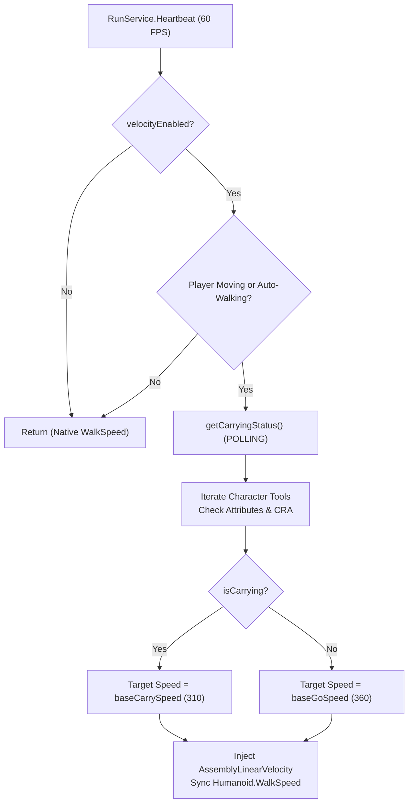

# Egg Go-To UI v11: Current Velocity & Speed Logic Analysis

This document outlines the current velocity physics and speed architecture implemented in [`farmer/EggGoToUI_v11.lua`](file:///home/arcobaleno/admin-tool/farmer/EggGoToUI_v11.lua).

---

## 1. Architecture Overview

In `v11`, player movement speed during automated travel and manual free-roam is augmented via a custom velocity physics loop (`RunService.Heartbeat`) that modifies `AssemblyLinearVelocity` on `HumanoidRootPart` and synchronizes `Humanoid.WalkSpeed`.

The current implementation uses a **dual-speed state machine**:
- **Go Speed (`baseGoSpeed = 360`)**: Applied when the player is moving toward an egg or free-roaming without carrying an egg.
- **Carry Speed (`baseCarrySpeed = 310`)**: Applied when the player is carrying an egg back to the safe zone.



---

## 2. Code Breakdown in `v11`

### 2.1 State Variables ([Lines 1491–1504](file:///home/arcobaleno/admin-tool/farmer/EggGoToUI_v11.lua#L1491-L1504))
```lua
local velocityEnabled = false
local weAreCarrying = false
local carryUid = nil
local baseGoSpeed = 360
local baseCarrySpeed = 310
local savedWalkSpeed = 16.0
```

### 2.2 UI Control Bar ([Lines 1673–1782](file:///home/arcobaleno/admin-tool/farmer/EggGoToUI_v11.lua#L1673-L1782))
The UI displays separate controls for each speed:
1. `velToggleBtn`: Toggle button switching between `[OFF] Velocity` and `[ON] Velocity`.
2. `goFrame` + `goBox`: Numeric `TextBox` for `baseGoSpeed` (default: `360`).
3. `carryFrame` + `carryBox`: Numeric `TextBox` for `baseCarrySpeed` (default: `310`).
4. `velLiveLabel`: Live text label showing active velocity magnitude.
5. `activityStatusLabel`: Text readout displaying status string:
   - `"Status: Not Carrying | Free Movement (360 studs/s)"`
   - `"Status: Carrying [EggName] (310 studs/s)"`

Two separate `FocusLost` listeners handle inputs:
```lua
addConnection(goBox.FocusLost:Connect(function()
    local val = tonumber(goBox.Text)
    if val and val > 0 then
        baseGoSpeed = math.clamp(math.floor(val), 16, 500)
    end
    goBox.Text = tostring(baseGoSpeed)
    updateActivityStatus()
end))

addConnection(carryBox.FocusLost:Connect(function()
    local val = tonumber(carryBox.Text)
    if val and val > 0 then
        baseCarrySpeed = math.clamp(math.floor(val), 16, 500)
    end
    carryBox.Text = tostring(baseCarrySpeed)
    updateActivityStatus()
end))
```

---

## 3. The Polling & Physics Loop

### 3.1 `updateVelocityPhysics` ([Lines 3136–3208](file:///home/arcobaleno/admin-tool/farmer/EggGoToUI_v11.lua#L3136-L3208))
Bound to `RunService.Heartbeat`, running every frame:
```lua
local function updateVelocityPhysics()
    local char = LocalPlayer and LocalPlayer.Character
    local hum = char and char:FindFirstChildOfClass("Humanoid")
    local hrp = char and char:FindFirstChild("HumanoidRootPart")
    if not (hum and hrp and hrp.Parent and hum.Health > 0) then return end

    if not velocityEnabled then
        return
    end

    local isMoving = (hum.MoveDirection.Magnitude > 0.05)
    if not activeWalkTarget and not isMoving then
        return
    end

    -- [ARCHITECTURAL ISSUE]: Polling carrying state inside the physics loop
    local isCarrying = getCarryingStatus()
    local targetSpeed = isCarrying and baseCarrySpeed or baseGoSpeed

    -- Applies AssemblyLinearVelocity according to targetSpeed...
```

### 3.2 `getCarryingStatus()` & `isHoldingEgg()` ([Lines 2583–2742](file:///home/arcobaleno/admin-tool/farmer/EggGoToUI_v11.lua#L2583-L2742))
To determine if `isCarrying` is true, the engine invokes:
1. `weAreCarrying` check.
2. `isHoldingEgg()`:
   - Iterates all children of `Character` looking for `Tool` instances.
   - Evaluates string matching (`c.Name:lower():find("egg")`).
   - Checks attributes (`IsEgg`, `HalloweenEggUid`).
   - Checks `hwCarryState.active`.
3. Checks `hwCarryState.isCarrying()`.
4. Uses a 0.25-second cache throttle (`os.clock() - lastCarryingCheck < 0.25`).

---

## 4. Key Architectural Flaws & Bloat

| Issue | Description | Impact |
| :--- | :--- | :--- |
| **Violation of Single-Domain Isolation** | The velocity physics loop's domain should be physics (applying velocity to `HumanoidRootPart`). It is currently inspecting character children, tool hierarchies, and attributes. | High coupling; physics loop breaks or lags if character hierarchy mutates unexpectedly. |
| **Violation of Push over Pull** | The script's state machine already explicitly executes events when an egg is picked up (`weAreCarrying = true`, line 6666), dropped (`handleEggDropped`, line 3058), or delivered (`handleEggDelivered`, line 3040). Polling on Heartbeat in reverse is redundant. | Unnecessary CPU cycles at 60 FPS. |
| **Dual Speed UI Complexity** | Having two separate speed fields ("Go" and "Carry") requires two frames, two textboxes, two `FocusLost` listeners, and double state tracking. | Clutters the UI and consumes register budget. |
| **Hardcoded References Across Script** | Functions in the Halloween dimension ([line 5508](file:///home/arcobaleno/admin-tool/farmer/EggGoToUI_v11.lua#L5508), [line 5521](file:///home/arcobaleno/admin-tool/farmer/EggGoToUI_v11.lua#L5521), [line 5885](file:///home/arcobaleno/admin-tool/farmer/EggGoToUI_v11.lua#L5885)) directly reference `baseCarrySpeed` instead of an abstracted speed provider. | Brittle refactoring surface. |
