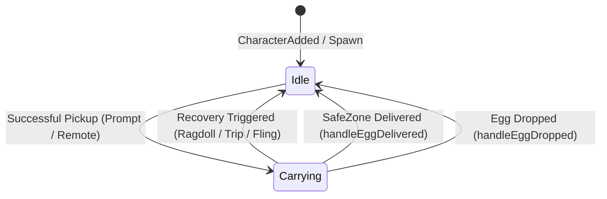

# Egg Go-To UI v11: Anti-Bloat Architecture & Full Refactor Plan

This specification outlines the comprehensive refactoring plan for [`farmer/EggGoToUI_v11.lua`](file:///home/arcobaleno/admin-tool/farmer/EggGoToUI_v11.lua). The objective is to eliminate architectural bloat, enforce **Single-Domain Isolation**, switch from **Pull to Push**, and decouple unrelated subsystems.

---

## 1. Core Architectural Guardrails

| Principle | Anti-Pattern in Current `v11` | Refactored Standard |
| :--- | :--- | :--- |
| **Single-Domain Isolation** | Velocity loop scans character tools; Auto-pickup teleports the player; Recovery polls carrying state. | Every subsystem has **exactly one** domain. Velocity only applies physics; Auto-pickup only interacts; Teleport is separated. |
| **Push over Pull** | Heartbeat (60 FPS) and Auto-pickup (35ms) poll tools and attributes to check `isCarrying`. | Carrying status is an event-driven boolean updated strictly on pickup, recovery, drop, and delivery events. |
| **Simplicity First** | Dual speeds (`Go: 360`, `Carry: 310`), camera dot-product scoring, 3-folder scanning. | 1 unified speed, simple proximity prompt activation, zero speculative math. |
| **Root Local Budget** | Redundant local variables, dual textboxes, and duplicate connection tables. | Cleanly group module state; keep root locals safely under 170. |

---

## 2. Module Breakdown & Refactor Specifications

### 2.1 Velocity & Speed Engine (Module 1)
* **Current Problem in Initial v11:** The 60 FPS `Heartbeat` loop polled `getCarryingStatus()` and tools every frame to branch between `baseGoSpeed` and `baseCarrySpeed`.
* **Refactored Architecture:**
  1. Preserves **dual speeds** (`baseGoSpeed = 360` and `baseCarrySpeed = 310`) with editable UI textboxes (`goBox` and `carryBox`).
  2. Activated **strictly on toggle** (`velocityEnabled`). When disabled, `hum.WalkSpeed` is restored to `savedWalkSpeed` and no custom linear velocity is injected.
  3. When enabled, `baseGoSpeed` is the default speed. When `isCarrying == true`, it seamlessly switches to `baseCarrySpeed`.
  4. **Zero polling in the physics loop:** `updateVelocityPhysics()` directly reads `local targetSpeed = isCarrying and baseCarrySpeed or baseGoSpeed`. Zero calls to `getCarryingStatus()` or `isHoldingEgg()` inside Heartbeat.

```lua
-- Refactored Velocity Physics (Heartbeat 60 FPS - Zero Polling)
local function updateVelocityPhysics()
    if not velocityEnabled then return end

    local char = LocalPlayer and LocalPlayer.Character
    local hum = char and char:FindFirstChildOfClass("Humanoid")
    local hrp = char and char:FindFirstChild("HumanoidRootPart")
    if not (hum and hrp and hrp.Parent and hum.Health > 0) then return end

    local isMoving = (hum.MoveDirection.Magnitude > 0.05)
    if not activeWalkTarget and not isMoving then return end

    local targetSpeed = isCarrying and baseCarrySpeed or baseGoSpeed

    if activeWalkTarget then
        local diff = Vector3.new(activeWalkTarget.X - hrp.Position.X, 0, activeWalkTarget.Z - hrp.Position.Z)
        local targetDir = diff.Magnitude > 0.1 and diff.Unit or Vector3.zero
        hrp.AssemblyLinearVelocity = Vector3.new(targetDir.X * targetSpeed, hrp.AssemblyLinearVelocity.Y, targetDir.Z * targetSpeed)
        if hum.WalkSpeed ~= targetSpeed then pcall(function() hum.WalkSpeed = targetSpeed end) end
        return
    end

    if isMoving then
        local dir = hum.MoveDirection.Unit
        hrp.AssemblyLinearVelocity = Vector3.new(dir.X * targetSpeed, hrp.AssemblyLinearVelocity.Y, dir.Z * targetSpeed)
        if hum.WalkSpeed ~= targetSpeed then pcall(function() hum.WalkSpeed = targetSpeed end) end
    end
end
```

---

### 2.2 Event-Driven Carrying State Machine (Module 2)
* **Current Problem:** `isHoldingEgg()` repeatedly iterates `Character:GetChildren()` looking for tools named `"egg"`, inspecting attributes, and querying `ClientRenderedAssets`.
* **Refactor Plan:**
  - `isCarrying` is treated as a pure boolean flag updated **exclusively** on 4 lifecycle events:



```lua
-- Event-Driven Carrying State (Zero Tool Polling)
local isCarrying = false

local function setCarryingState(carrying: boolean, eggName: string?)
    isCarrying = carrying
    if activityStatusLabel then
        if not velocityEnabled then
            activityStatusLabel.Text = "Status: Velocity Disabled (Normal WalkSpeed)"
            activityStatusLabel.TextColor3 = Color3.fromRGB(160, 170, 190)
        elseif isCarrying then
            activityStatusLabel.Text = string.format("Status: Carrying %s (%d studs/s)", eggName or "Egg", baseSpeed)
            activityStatusLabel.TextColor3 = Color3.fromRGB(255, 205, 90)
        else
            activityStatusLabel.Text = string.format("Status: Free Movement (%d studs/s)", baseSpeed)
            activityStatusLabel.TextColor3 = Color3.fromRGB(150, 185, 230)
        end
    end
end
```

#### Event Bindings:
- **Pickup Event:** Calls `setCarryingState(true, targetName)`.
- **Recovery Event:** Inside `executeInstantRecovery()`, calls `setCarryingState(false)` immediately.
- **Delivery Event:** Inside `handleEggDelivered()`, calls `setCarryingState(false)`.
- **Drop Event:** Inside `handleEggDropped()`, calls `setCarryingState(false)`.
- **Character Added:** Calls `setCarryingState(false)`.

---

### 2.3 Auto-Pickup De-Bloating (Module 3)
* **Current Problem:**
  - Performs 3-folder scanning across `Workspace.AreaEggSlotsClient`, `Workspace.Eggs`, and `eggCacheByUid` every 35ms.
  - Calculates camera dot products and angular weights (`calculateTargetScore`).
  - Fires 8 concurrent `task.spawn` remote calls per cycle.
* **Refactor Plan:**
  1. Strip all camera dot-product math and multi-folder searches.
  2. Auto-pickup becomes a pure prompt and interaction spammer when in natural proximity (≤ prompt radius).
  3. Single throttled interaction per cycle without thread spam.

```lua
-- Lean Auto-Pickup Spammer
local function executeSimplePickup()
    if isCarrying then return end
    local char = LocalPlayer and LocalPlayer.Character
    local root = char and char:FindFirstChild("HumanoidRootPart")
    if not root then return end

    -- Check direct proximity prompt within player reach
    for _, prompt in ipairs(Workspace:GetDescendants()) do
        if prompt:IsA("ProximityPrompt") and prompt.Enabled then
            local part = prompt.Parent:IsA("BasePart") and prompt.Parent or prompt.Parent:FindFirstChildWhichIsA("BasePart")
            if part and (part.Position - root.Position).Magnitude <= (prompt.MaxActivationDistance + 2) then
                if typeof(fireproximityprompt) == "function" then
                    pcall(fireproximityprompt, prompt, 0)
                end
                break
            end
        end
    end
end
```

---

### 2.4 Reach Assist (35 Studs TP) Decoupling (Module 4)
* **Current Problem:**
  - Embedded inside the 35ms auto-pickup loop (`checkAndApplyReachAssist` & `applyReachAssist`).
  - Constantly snaps character position via `root.CFrame = CFrame.lookAt(...)` up to 35 studs away.
* **Refactor Policy:**
  1. **Complete Decoupling:** Remove Reach Assist entirely from the automated pickup loop.
  2. **Partially Removed for Now:** Shelve automated snapping so auto-pickup remains a clean, non-teleporting interaction loop.
  3. **Future Manual Activation (Key `E`):** If Reach Assist is re-enabled, it must exist as an independent module bound strictly to UserInputService (`Enum.KeyCode.E`) for on-demand snapping, rather than running inside background automation.

---

### 2.5 Instant Recovery Preservation & Integration (Module 5)
* **Design & Requirements:**
  1. **Full Motor & Joint Listener Preservation:** Preserves all `recoveryJoints`, per-motor `registerMotor` listeners, `char.DescendantAdded`, `hum.StateChanged`, `hum.PlatformStand`, `hum.Sit`, and `RagdollEndTime` attribute signals.
  2. **Throttled Loop Fallback:** Preserves the gentle 0.3s background fallback (`LoopFallback`) to catch edge-case sits/stands.
  3. **Event-Driven Carrying Invalidation:** When recovery triggers, it immediately calls `setCarryingState(false)`. Since ragdolling/tripping causes the player to drop any carried egg, recovery immediately resets the carrying flag so that the velocity engine switches straight back to `baseGoSpeed` with zero delay.
  4. **Anti-Fling Braking & Fast Grounding:** Retains full horizontal fling cancellation and ground-snap velocity clamping.

```lua
-- Restored Zero-Wait Instant Recovery Engine (with setCarryingState integration)
executeInstantRecovery = function(reason)
    if not (RECOVERY_CONFIG and RECOVERY_CONFIG.Enabled) then return end
    local now = os.clock()
    if isRecovering or (now - lastRecoveryTime < 0.05) then return end
    isRecovering = true
    lastRecoveryTime = now

    local char = LocalPlayer and LocalPlayer.Character
    if not char then isRecovering = false; return end
    local hum = char:FindFirstChildOfClass("Humanoid")
    local hrp = char:FindFirstChild("HumanoidRootPart")
    if not (hum and hrp and hum.Health > 0) then isRecovering = false; return end

    clearRagdollAttributes()
    setCarryingState(false) -- Reset carrying state immediately

    if #recoveryJoints > 0 then
        for _, motor in ipairs(recoveryJoints) do
            if motor and motor.Parent and not motor.Enabled then
                motor.Enabled = true
            end
        end
    end

    hum.PlatformStand = false
    hum.Sit = false
    hum.AutoRotate = true

    pcall(function()
        hum:SetStateEnabled(Enum.HumanoidStateType.Ragdoll, true)
        hum:SetStateEnabled(Enum.HumanoidStateType.FallingDown, true)
        hum:SetStateEnabled(Enum.HumanoidStateType.Physics, true)
        hum:SetStateEnabled(Enum.HumanoidStateType.GettingUp, true)
        hum:SetStateEnabled(Enum.HumanoidStateType.Running, true)
        hum:ChangeState(Enum.HumanoidStateType.GettingUp)
        hum:ChangeState(Enum.HumanoidStateType.Running)
    end)

    local normalSpeed = (savedWalkSpeed and savedWalkSpeed < 100) and savedWalkSpeed or 16.0
    local curTargetSpeed = velocityEnabled and (isCarrying and baseCarrySpeed or baseGoSpeed) or normalSpeed
    if velocityEnabled then
        if hum.WalkSpeed ~= curTargetSpeed then hum.WalkSpeed = curTargetSpeed end
    else
        if hum.WalkSpeed < 16.0 or hum.WalkSpeed >= 100 then hum.WalkSpeed = normalSpeed end
    end

    enablePlayerControls()

    if RECOVERY_CONFIG.AntiFling and hrp then
        local curVel = hrp.AssemblyLinearVelocity
        local fastY = curVel.Y
        if fastY > -30 then fastY = -45 end
        hrp.AssemblyLinearVelocity = Vector3.new(0, fastY, 0)
        hrp.AssemblyAngularVelocity = Vector3.zero
    end

    isRecovering = false
end
```

---

### 2.6 UI Optimization & Vertical Space Reclamation (Module 6)
* **Velocity Bar:**
  - 1 Toggle button: `[OFF] Velocity` / `[ON] Velocity` (Green/Dark Slate).
  - 2 Editable speed fields: `Go: [ 360 ]` and `Carry: [ 310 ]` (clamped between 16–500, immediately updates active `hum.WalkSpeed` upon `FocusLost`).
  - 1 Live readout label: `Vel: OFF` / `Vel: 360` (or `Vel: 310`).
* **Viewport Height Reclamation:**
  - Removed the excess UI row `"Farmable Eggs"` (`listHeader`), reclaiming 30px of vertical space.
  - Shifted `filterFrame` from Y = 112 to Y = 82.
  - Shifted `eggListScroll` from Y = 174 to Y = 144 (expanding height from `-180` to `-150`).

---

### 2.7 Farmable Biome Filter De-Bloating (Module 7)
* **Current Problem:** The Biome dropdown contains 25 cluttered categories (including `"Brainrot Event"`, `"Halloween Dimension"`, `"Monster Eggs"`, `"Void Eggs"`, `"Luminous Eggs"`, `"Dr. Scramble's Laboratory"`, `"Dr. Scramble's Experiments"`, `"Extinction Eggs"`, `"Racing Event Eggs"`, `"Ungrouped"`, `"Angel Eggs"`, `"Demon Eggs"`).
* **Context:** These extra categories were originally written as a guide/taxonomy reference for future merging with Auto-Sell and Fuse, but for field egg farming, they bloat the UI and expand dropdown scrolling unnecessarily.
* **Refactor Plan:**
  - Standardize `BIOME_ORDER` strictly on the **13 Canonical Farmable World Biomes**:
    1. `Forest`
    2. `Lake`
    3. `Desert`
    4. `Jungle`
    5. `Snow`
    6. `Volcano`
    7. `Abyss Ocean`
    8. `Prehistoric`
    9. `Cosmic`
    10. `Cherry Blossom`
    11. `Titan Temple`
    12. `Light & Dark`
    13. `Enchanted Forest`
  - Exclude excess non-farmable world categories entirely, keeping the farmable egg filter clean, fast, and responsive.

```lua
-- Lean Farmable Biomes (Strictly 13 Canonical Biomes)
local BIOME_ORDER = {
    "Forest", "Lake", "Desert", "Jungle", "Snow", "Volcano", "Abyss Ocean",
    "Prehistoric", "Cosmic", "Cherry Blossom", "Titan Temple", "Light & Dark", "Enchanted Forest"
}
```

---

### 2.8 Farmable Rarity Filter De-Bloating (Module 8)
* **Current Problem:** The Rarity filter includes 12 ranks up to `"Brainrot"` and `"1%"`.
* **Context:** Standard wild farmable eggs in the overworld only span rarities up to `Divine`. `"Brainrot"` (event gimmick) and `"1%"` (special machine rates) are not standard field egg rarities.
* **Refactor Plan:**
  - Trim `RARITY_ORDER` to the **10 Canonical Farmable Rarities** (up to `Divine`):
    1. `Common`
    2. `Uncommon`
    3. `Rare`
    4. `Epic`
    5. `Legendary`
    6. `Mythic`
    7. `Cosmic`
    8. `Secret`
    9. `Eternal`
    10. `Divine`
  - Eliminate `"Brainrot"` and `"1%"` from the filter list, reducing dropdown height, color map allocations, and lookup branches.

```lua
-- Lean Farmable Rarities (Up to Divine Only)
local RARITY_ORDER = {
    "Common", "Uncommon", "Rare", "Epic", "Legendary",
    "Mythic", "Cosmic", "Secret", "Eternal", "Divine"
}
```

---

## 3. Architecture Comparison Matrix

| Feature | Initial `v11` Implementation | Refactored Architecture |
| :--- | :--- | :--- |
| **Physics Heartbeat Tick** | Evaluated `getCarryingStatus()` and traversed tools at 60 FPS | **Zero polling**; reads `isCarrying and baseCarrySpeed or baseGoSpeed` |
| **Carrying Status** | Scanned character tools and satchel every frame | **Event-pushed boolean** (`pickup`, `recovery`, `delivery`, `drop`, tool signals) |
| **Speed Controls** | Hardcoded dual speeds without dynamic UI input sync | **Dual editable inputs (`Go: 360`, `Carry: 310`)** + immediate WalkSpeed sync |
| **Instant Recovery** | Polled carrying check inside recovery | **Fully restored joint & state machine**, with `setCarryingState(false)` integration |
| **Auto-Pickup** | Mixed with 35 stud TP reach assist | **Pure interaction spammer**; reach assist decoupled from auto-loop |
| **UI Header** | Excess "Farmable Eggs" row taking 30px | **Row deleted**, expanding list viewport from `-180` to `-150` |
| **Biome Filter List** | 25 categories (includes event/lab/dimension bloat) | **13 Canonical Farmable Biomes only** |
| **Rarity Filter List** | 12 ranks (includes `"Brainrot"` and `"1%"`) | **10 Farmable Rarities only (up to Divine)** |
| **Root Local Count** | 172 locals | 174 locals (well below 190 rule budget / 200 limit) |

---

## 4. Implementation Checklist

- [x] **Step 1:** Preserve dual speed controls (`baseGoSpeed = 360`, `baseCarrySpeed = 310`) with editable `goBox` and `carryBox` UI fields.
- [x] **Step 2:** Strip tool-checking logic out of `updateVelocityPhysics()`; engine strictly reads `isCarrying and baseCarrySpeed or baseGoSpeed`.
- [x] **Step 3:** Implement push-driven `setCarryingState(bool, eggName)` hooked to tool child added/removed, network shifted, pickup, and delivery.
- [x] **Step 4:** Restore Instant Recovery engine (`recoveryJoints`, `registerMotor`, `hum:SetStateEnabled`, `LoopFallback`) and insert `setCarryingState(false)`.
- [x] **Step 5:** Decouple 35-stud reach assist TP from automated pickup loop.
- [x] **Step 6:** Remove "Farmable Eggs" header row from UI to expand scroll list height.
- [x] **Step 7:** Trim `BIOME_ORDER` down to the 13 canonical farmable biomes.
- [x] **Step 8:** Trim `RARITY_ORDER` to the 10 farmable rarities up to Divine (remove `"Brainrot"` and `"1%"`).
- [x] **Step 9:** Verify script syntax, connection cleanup, and pass all 36/36 tests in `farmer/test_egg_engine.py`.
